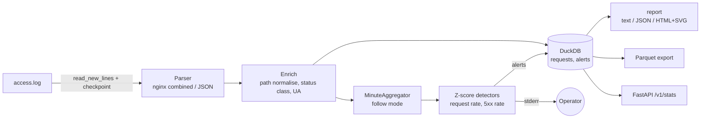

<!-- topics: python,log-analysis,nginx,duckdb,data-pipeline,anomaly-detection,typer,observability,parquet -->
# Log Analytics Pipeline

Batch and tail-mode analytics for nginx and JSON access logs: parse, enrich, store in DuckDB, report percentiles and anomalies, export Parquet.

[](https://github.com/AkibUllah/log-analytics-pipeline/actions/workflows/ci.yml)


## Why this exists

Most of the incidents I have debugged on payment and e-commerce APIs were first visible in the nginx access log, long before anyone opened a dashboard: a p95 that doubled on the bKash execute endpoint, a 5xx burst on one upstream, a scraper hammering product pages. Shipping those logs to a hosted stack is the right answer at scale, but a lot of client deployments are a couple of VMs where that is overkill. `logpipe` is the single-binary-feeling alternative: it reads the log you already have, keeps an analytical store in one DuckDB file, answers "what happened in the last hour" in a second, and watches the live file for anomalies.

## Features

- Parsers for nginx `combined` (with the common `$request_time` suffix) and line-delimited JSON logs with flexible key names; malformed lines are counted, never fatal; format auto-detection
- Enrichment: path normalisation (`/users/123/orders/9f1c...` to `/users/{id}/orders/{uuid}`, hashed static assets to `/static/{file}.js`), status class, device / browser / bot classification
- DuckDB storage with vectorised bulk loading (50,000 rows in under a second), per-minute series with gap filling, exact p50/p95/p99 via `quantile_cont`, top endpoints, slowest endpoints, top IPs, device and status breakdowns, Parquet export
- A mergeable t-digest-style `QuantileSketch` for streaming percentiles in follow mode (within 3% of exact on 50k lognormal samples in the tests)
- Incremental ingest with a JSON checkpoint (inode + byte offset): re-running `ingest` on the same file is a no-op, rotation and truncation restart cleanly, partial trailing lines are held until complete
- `follow` mode: asyncio `tail -F` that ingests new lines, scores each completed minute and prints alerts
- Anomaly detection: z-score against a trailing window for request rate and 5xx rate, with a spread floor so quiet traffic does not trigger on a single error and with anomalous minutes excluded from the baseline so a sustained incident keeps alerting
- Text report, JSON report and a self-contained HTML report with inline SVG charts (no JavaScript, no external assets)
- Realistic synthetic log generator (daily traffic curve, e-commerce/payments endpoint mix, bots, scanners, a 5xx incident and a flash crowd) for demos and tests
- Optional read-only FastAPI stats endpoint; Dockerfile and compose with a shared DuckDB volume

## Architecture



Key decisions:

- **DuckDB as the store.** Columnar, embedded, zero operations, and the analytical queries (percentiles, grouped counts, time-bucketed series) are one SQL statement each. Inserts are staged to a CSV and loaded with `read_csv`, which is roughly 300x faster than `executemany` for the 5k-row batches the pipeline uses.
- **Checkpoint by inode and offset, not by line hash.** Cheap, exact, and it survives `logrotate` in both `create` and `copytruncate` modes. A partial last line is deliberately left unread.
- **Alerts are computed from completed minutes only.** In follow mode the current minute is always partially filled; scoring it would look like a traffic drop every few seconds.
- **Baselines exclude anomalies.** An incident that lasts 20 minutes should produce 20 alerts, not three alerts and then silence because the spike became the new mean.
- **Two detectors, two floors.** Request rate uses an absolute floor of 5 req/min; error rate uses 5 percentage points. Both are configurable per run (`--z`, `--window`).

## Tech Stack

| Layer | Choice |
|---|---|
| Storage / queries | DuckDB 1.x, Parquet export |
| CLI | Typer, Rich |
| Streaming | asyncio follow loop, in-memory per-minute aggregation, t-digest-style sketch |
| API (optional) | FastAPI (`pip install ".[api]"`) |
| Tooling | pytest + pytest-asyncio, ruff, GitHub Actions (3.10 / 3.11 matrix, CLI smoke test, docker build) |

## Quick Start

### Local

```bash
git clone git@github.com:AkibUllah/log-analytics-pipeline.git
cd log-analytics-pipeline
make install                                   # venv + editable install with dev extras

.venv/bin/logpipe generate-sample --lines 50000 --out data/access.log
.venv/bin/logpipe ingest data/access.log       # -> logpipe.duckdb, logpipe.checkpoint.json
.venv/bin/logpipe report --since 24h
.venv/bin/logpipe report --since 6h --html report.html
.venv/bin/logpipe export requests.parquet --since 1d
```

Tail a live file (an alert prints to stderr whenever a completed minute is anomalous):

```bash
.venv/bin/logpipe follow /var/log/nginx/access.log --interval 2 --z 3 --window 30
```

### Docker Compose

```bash
docker compose up --build -d      # follow tails ./data/access.log, api serves :8080
curl -s 'localhost:8080/v1/stats?since=1h' | jq '.total_requests, .percentiles'
```

## Usage

A real run on the synthetic sample (`generate-sample --lines 50000`, 24 hours of traffic with one 5xx incident and one flash crowd injected):

```text
logpipe report  (2026-10-19 17:59 -> latest UTC)
========================================================================
Data range      2026-10-19 18:00 -> 2026-10-20 17:59 UTC
Requests        50,000  (34.7/min avg, peak 157/min at 13:15)
5xx error rate  0.70%
Bytes sent      440.0 MB
Latency         p50 44 ms   p95 261 ms   p99 681 ms   (50,000 samples)

Status classes
  class  requests  share
  -----  --------  -----
  2xx      44,060  88.1%
  3xx       4,555   9.1%
  4xx       1,036   2.1%
  5xx         349   0.7%

Slowest endpoints (p95, >= 20 requests)
  path                                  p95  requests
  -------------------------------  --------  --------
  /api/v1/payments/bkash/execute   1,810 ms       696
  /api/v1/payments/bkash/create      950 ms       781
  /api/v1/orders                     496 ms     1,629
  /api/v1/search                     390 ms     2,530
  /api/v1/auth/login                 312 ms     1,324
  ...

Anomalies (18)
  [warning] 5xx error rate 27.3% at 2026-10-20 08:52 (baseline 0.21% +/- 0.78%, z=5.4)
  [critical] 5xx error rate 36.4% at 2026-10-20 08:53 (baseline 0.21% +/- 0.78%, z=7.2)
  [warning] 5xx error rate 18.2% at 2026-10-20 08:54 (baseline 0.21% +/- 0.78%, z=3.6)
  [critical] 5xx error rate 32.4% at 2026-10-20 09:02 (baseline 0.21% +/- 0.78%, z=6.4)
  [critical] 5xx error rate 44.1% at 2026-10-20 09:03 (baseline 0.21% +/- 0.78%, z=8.8)
  [critical] request rate 156/min at 2026-10-20 13:12 (baseline 47.9 +/- 0.3, z=21.6)
  [critical] request rate 156/min at 2026-10-20 13:13 (baseline 47.9 +/- 0.3, z=21.6)
  ...
```

The 18 alerts are exactly the 12 incident minutes and the 6 flash-crowd minutes the generator injected; none of the 1,422 ordinary minutes were flagged.

Common commands:

| Command | What it does |
|---|---|
| `logpipe ingest FILE [--format nginx\|json\|auto] [--no-checkpoint]` | Parse new lines since the last checkpoint into DuckDB |
| `logpipe follow FILE [--interval 1] [--z 3] [--window 30]` | Tail the file, ingest, alert on anomalous minutes |
| `logpipe report [--since 1h] [--until 10m] [--anchor latest\|now] [--html out.html] [--json]` | Summary, percentiles, top lists, anomalies |
| `logpipe export out.parquet [--since 1d]` | Parquet export of a window |
| `logpipe generate-sample [--lines N] [--minutes M] [--format json] [--no-incident]` | Synthetic log |
| `logpipe serve [--port 8080]` | Read-only API: `/health`, `/v1/stats`, `/v1/alerts` |

`--since` is relative to the newest record by default (`--anchor latest`), which is what you want when analysing an archived file; pass `--anchor now` for a live log. Settings can also come from `LOGPIPE_*` environment variables (see [`.env.example`](.env.example)).

## Project Structure

```
logpipe/
├── cli.py          # Typer commands
├── parsers.py      # nginx combined + JSON parsers, format detection
├── enrich.py       # path normalisation, status class, UA classification
├── models.py       # LogRecord
├── pipeline.py     # file -> parse -> enrich -> store glue
├── checkpoint.py   # inode/offset checkpoint, incremental reader
├── follow.py       # asyncio tail -F with per-minute scoring
├── aggregate.py    # MinuteAggregator (in-memory buckets, top counters)
├── anomaly.py      # ZScoreDetector, AnomalyMonitor, Alert
├── percentiles.py  # exact percentiles + QuantileSketch
├── storage.py      # DuckDB Store: bulk load, queries, Parquet export
├── report.py       # Report model, text + HTML/SVG renderers
├── generator.py    # synthetic log generator
├── timeutil.py     # --since/--until parsing
├── api.py          # optional FastAPI stats service
└── config.py       # LOGPIPE_* settings
data/sample_access.log   # 3,000-line sample (3 hours, includes an incident)
tests/                   # 60 tests
Dockerfile · docker-compose.yml · Makefile · .github/workflows/ci.yml
```

## Testing

```bash
make test     # pytest
make lint     # ruff check + ruff format --check
```

Covered: both parsers (timezone conversion, missing fields, malformed lines, epoch-ms and ISO timestamps), path normalisation table, status classes, UA classification, exact percentiles and sketch accuracy against exact values, per-minute aggregation with gap filling and retention, detector warm-up / spike / baseline isolation / spread floor / per-minute dedupe, checkpoint batching, resume, partial lines, rotation and truncation, DuckDB queries against independently computed expectations, Parquet export, alert persistence, generator determinism and incident injection, report rendering (text and HTML), asyncio follow mode with alerting, CLI end-to-end via `CliRunner`, and the API.

## Roadmap

- Geo enrichment (MaxMind) and ASN grouping for the top-IP table
- Seasonal baselines (same minute last week) in addition to the trailing window
- Alert sinks: webhook and Slack, with per-metric cooldowns
- Multi-file ingest with glob patterns and compressed (`.gz`) rotated files
- Retention job that compacts old minutes into hourly rollups inside DuckDB

## License

MIT. See [LICENSE](LICENSE).
